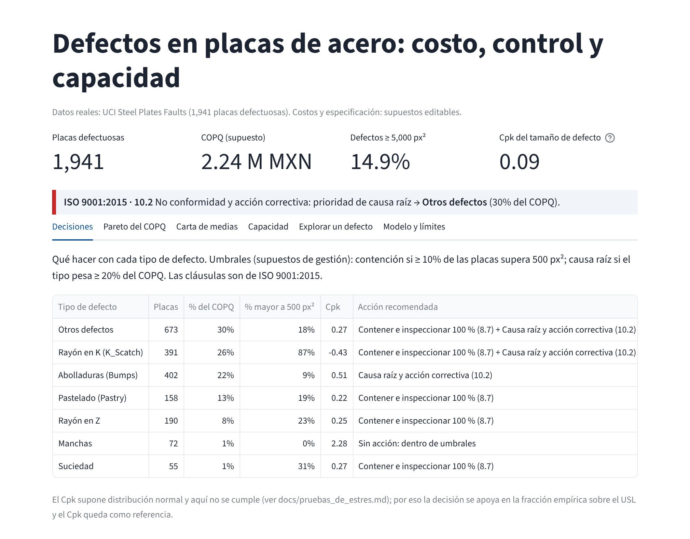

# Inteligencia de calidad: clasificación de defectos en placas de acero

[English](README.md) · **Español**

**Un problema industrial de calidad convertido en evidencia medible: contrato de datos, validación científica, un modelo evaluado una sola vez sobre un holdout independiente, análisis de errores y apoyo a la decisión en Power BI, todo reproducible desde este repositorio.**

## En un minuto

| | |
|---|---|
| **Problema** | Un área de calidad necesita saber qué tipo de defecto tiene cada placa ya inspeccionada, dónde se equivoca la clasificación y qué casos merecen revisión humana. |
| **Datos** | *Steel Plates Faults* (UCI): 1,941 placas, **todas con defecto**, 27 medidas por placa y 7 tipos de defecto. Sin fechas, máquinas, turnos ni proveedores. |
| **Qué predice el modelo** | Dadas las medidas de una placa **ya caracterizada como defectuosa**, el tipo de defecto entre 7 clases (`FULL_OBSERVATION_CLASSIFICATION_ONLY`). |
| **Qué NO predice** | Si una placa tendrá defecto, el defecto antes de que ocurra, ni sus causas. No es mantenimiento predictivo ni un sistema en producción (`EARLY_PREDICTION_SUPPORTED = FALSE`). |
| **Modelo final** | Random Forest congelado (300 árboles, `class_weight="balanced"`, `random_state=42`), elegido solo con validación cruzada. |
| **Resultado en holdout** | 389 placas nunca usadas para decidir: **macro-F1 0.815**, balanced accuracy 0.805, log-loss 0.689. CV de desarrollo: macro-F1 0.801 ± 0.028. |
| **Rol de Power BI** | Capa de *quality intelligence*: distribución de defectos, COPQ con costos supuestos, carta por grupos, Cpk de referencia y una página de desempeño del modelo y revisión. |
| **Evidencia** | [Model Card](MODEL_CARD.md) · [Evidence pack](docs/evidence/README.md) · [manifest del modelo](artifacts/manifest.json) |

## Del problema a la evidencia

1. **Formulación medible.** Contrato del problema y política de features: 27 medidas, sin `id` ni columnas objetivo ([contrato](docs/ml/02_problem_contract.md), [auditoría de fuga](docs/ml/03_leakage_audit.md)).
2. **Validación científica.** Split estratificado 1,552 / 389; `StratifiedKFold(5, shuffle=True, random_state=42)` solo sobre entrenamiento; baseline → candidatos → ajuste controlado → selección ([04](docs/ml/04_baseline_evaluation.md)–[06](docs/ml/06_tuning_and_selection.md)).
3. **Evaluación independiente.** El modelo congelado se evaluó **una vez** en el holdout. Sin ajuste posterior, sin comparar alternativas en holdout, sin calibrar ([07](docs/ml/07_final_holdout_evaluation.md)).
4. **Errores e incertidumbre.** 82 errores de 389; la confusión Abolladuras ↔ Otros defectos explica 36. Pastry es la clase más débil (F1 0.60). Las probabilidades no están calibradas ([08](docs/ml/08_error_uncertainty_interpretability.md)).
5. **Apoyo a la decisión.** Política candidata de revisión (solo desarrollo): confianza ≥ 0.80 se acepta, el resto va a revisión. Aplicada *post hoc* al holdout envía 261 casos a revisión, que contienen 81 de los 82 errores. No es un umbral validado para operación.
6. **Reproducibilidad.** Artefacto del modelo con huellas SHA256 de datos, split, features y configuración; inferencia por lotes con validación estricta de esquema; CI ([09](docs/ml/09_model_lineage_and_batch_inference.md)).

### Desempeño por clase (holdout)

| Clase | Precisión | Recall | F1 | n |
|---|---:|---:|---:|---:|
| Pastry | 0.571 | 0.625 | 0.597 | 32 |
| Z_Scratch | 0.971 | 0.868 | 0.917 | 38 |
| K_Scatch | 0.973 | 0.910 | 0.940 | 78 |
| Stains | 0.923 | 0.857 | 0.889 | 14 |
| Dirtiness | 0.909 | 0.909 | 0.909 | 11 |
| Bumps | 0.714 | 0.679 | 0.696 | 81 |
| Other_Faults | 0.726 | 0.785 | 0.754 | 135 |

Stains y Dirtiness tienen muy poco soporte: no permiten conclusiones estables.

## Capa de quality intelligence (Power BI y Streamlit)

El tablero responde dónde actuar primero con un presupuesto limitado, con umbrales de gestión **supuestos** y la cláusula ISO 9001:2015 que respalda cada acción:

| Señal | Umbral (supuesto de gestión) | Acción | ISO 9001:2015 |
|---|---|---|---|
| ≥ 10 % de las placas con defecto mayor a 500 px² | `UMBRAL_FUERA_USL_PCT` | Contener: segregar e inspeccionar al 100 % | 8.7 |
| Un tipo pesa ≥ 20 % del COPQ | `UMBRAL_COPQ_PCT` | Análisis de causa raíz y acción correctiva | 10.2 |
| Cpk < 1.00 sin otra señal | Referencia, no criterio único | Vigilar y evaluar | 9.1.3 |

Hallazgos descriptivos (con **costos ilustrativos**, no ahorros demostrados): tres tipos concentran el 77.7 % del COPQ supuesto; el rayón en K es 267 de los 289 defectos ≥ 5,000 px² y está casi confinado al acero A400 y al espesor 40 (710 de 1,941 placas). Cada conclusión se sometió a [pruebas de estrés](docs/pruebas_de_estres.md): el trío de mayor costo resiste en 99 % de 2,000 simulaciones, pero el primer lugar no.



- Proyecto PBIP en [`powerbi/project/`](powerbi/project/) y PBIX en [`powerbi/artifacts/`](powerbi/artifacts/) (Git LFS: ejecuta `git lfs pull` tras clonar).
- La página *MODEL PERFORMANCE & REVIEW* y la tabla `ML_Holdout` se reconciliaron contra Python (389 filas, 307 aciertos, 82 errores, 261 a revisión) solo a nivel de exportación: [reconciliación](docs/evidence/powerbi_ml_reconciliation.md).
- **La validación en Power BI Desktop está pendiente** (abrir, refrescar, renderizar y guardar): `POWER_BI_RUNTIME = MANUAL_VALIDATION_REQUIRED`. Pasos exactos en el [handoff](docs/evidence/powerbi_runtime_handoff.md). El PBIX publicado aún no contiene la página ML.
- El parámetro `RutaCSV` del PBIP trae una ruta de ejemplo (`C:\path\to\...`); ajústalo en Desktop a `data/raw/steel_plates_faults.csv` de tu clon.

## Cómo reproducir

Requiere Python 3.13 (entorno registrado: 3.13.7) y Git LFS.

```bash
git clone https://github.com/jesusgonzalezmexdata-ux/steel-plates-quality-mlops-.git
cd steel-plates-quality-mlops-
git lfs pull
python -m venv .venv
source .venv/bin/activate            # Windows: .venv\Scripts\activate
pip install -r requirements-dev.txt

python -B -m tools.project_checks validate-data       # auditoría del dataset (1,941 filas)
python -B -m tools.project_checks validate-artifact   # linaje y SHA256 del modelo congelado
python -B -m tools.project_checks batch-smoke         # inferencia por lotes (filas de entrenamiento)
python -B -m tools.project_checks validate-evidence   # exportación Power BI vs. evidencia Python
python -B -m pytest -q                                # suite completa (~10 min: incluye replays)
streamlit run streamlit_app.py                        # tablero equivalente en Streamlit
```

Contrato de datos en SQL (dbt + DuckDB), conciliado contra la auditoría de Python:

```bash
pip install -r requirements-dbt.txt
python -B -m tools.data_contract        # dbt build (56 checks) + conciliación fila a fila con pandas
python -B -m pytest -q tests/test_data_contract.py   # incluye 5 corrupciones que deben fallar
```

El contrato fija nombres y tipos de las 35 columnas (`contract: enforced`), unicidad de `id`, nulos, one-hot exclusivo de clase y de acero, distribución exacta por clase, filas = 1,941, coherencia geométrica y rangos de los índices normalizados ([`dbt/`](dbt/)).

Modelo exportado a ONNX e inferencia desde otro lenguaje (Node.js):

```bash
pip install -r requirements-onnx.txt
python -B -m tools.export_onnx --check      # exporta, exige el mismo SHA256 y la equivalencia con scikit-learn
cd examples/onnx-node && npm ci && node predict.mjs   # inferencia con ONNX Runtime desde JavaScript
```

El ONNX es un artefacto derivado del modelo congelado, no lo reemplaza. Reproduce la semántica float32 de los árboles de scikit-learn: en 1,552 filas de entrenamiento y 2,000 sintéticas la diferencia máxima de probabilidad es 8.3e-7 (tolerancia 1e-6), con la misma clase y el mismo estado de revisión en todos los casos. No se hizo inferencia sobre el holdout ([informe](reports/onnx/verification.json)).

Con Docker (mismo sistema operativo y dependencias en cualquier equipo; no requiere Python local):

```bash
docker build -t steel-plates-quality-mlops .
docker run --rm steel-plates-quality-mlops                                  # checks de evidencia y artefacto
docker run --rm steel-plates-quality-mlops python -B -m pytest -q -p no:cacheprovider   # suite completa
```

La CI construye esta imagen y ejecuta ambos comandos en cada push. Power BI Desktop queda fuera del contenedor.

Inferencia sobre un CSV propio con las 27 columnas (opcional `row_id`):

```bash
pip install .                     # instala el comando steel-predict
steel-predict --root . --input input.csv --output predictions.csv
```

Carga el modelo solo desde un checkout de confianza: joblib/pickle ejecuta código al cargar.

## Evidencia

- [Model Card](MODEL_CARD.md): uso previsto, fuera de alcance, validación, fallos conocidos y límites.
- [Evidence pack](docs/evidence/README.md): índice navegable y trazabilidad de cada afirmación.
- [Estado de ejecución](docs/PROJECT_EXECUTION_STATE.md): fases, checkpoints e invariantes del holdout.

## Limitaciones

- **Solo clasificación con observación completa.** No hay placas buenas ni variables temporales; la disponibilidad temporal de las 27 medidas no está demostrada.
- **Holdout consumido.** Ya no es un test virgen; cualquier modelo nuevo necesitaría datos nuevos.
- **Clases pequeñas y política de revisión sin validación prospectiva.** La importancia de variables es asociativa, no causal; las probabilidades no están calibradas.
- **Power BI Desktop sin validar en ejecución**; la reconciliación cubre la exportación de Python.
- **Costos, límite de especificación y umbrales de acción supuestos.** No se reclama impacto financiero ni despliegue en producción.
- **Confusión entre espesor y tipo de defecto**: el 99 % del rayón en K cae en espesor 40.

---

**Jesús R. L. González** · Analista y Científico de Datos · Operaciones y Calidad en manufactura · [LinkedIn](https://www.linkedin.com/in/jesus-r-l-gonzalez)

## Licencia y cita

- **Código y documentación:** [Apache License 2.0](LICENSE). Ver [NOTICE](NOTICE).
- **Dataset:** Buscema, M., Terzi, S., & Tastle, W. (2010). *Steel Plates Faults* [Dataset]. UCI Machine Learning Repository. https://doi.org/10.24432/C5J88N — licencia [CC BY 4.0](https://creativecommons.org/licenses/by/4.0/); la licencia Apache no se aplica a los datos.
- **Citar este repositorio:** usa el botón *Cite this repository* de GitHub ([CITATION.cff](CITATION.cff)). Historial de versiones en [CHANGELOG](CHANGELOG.md).
