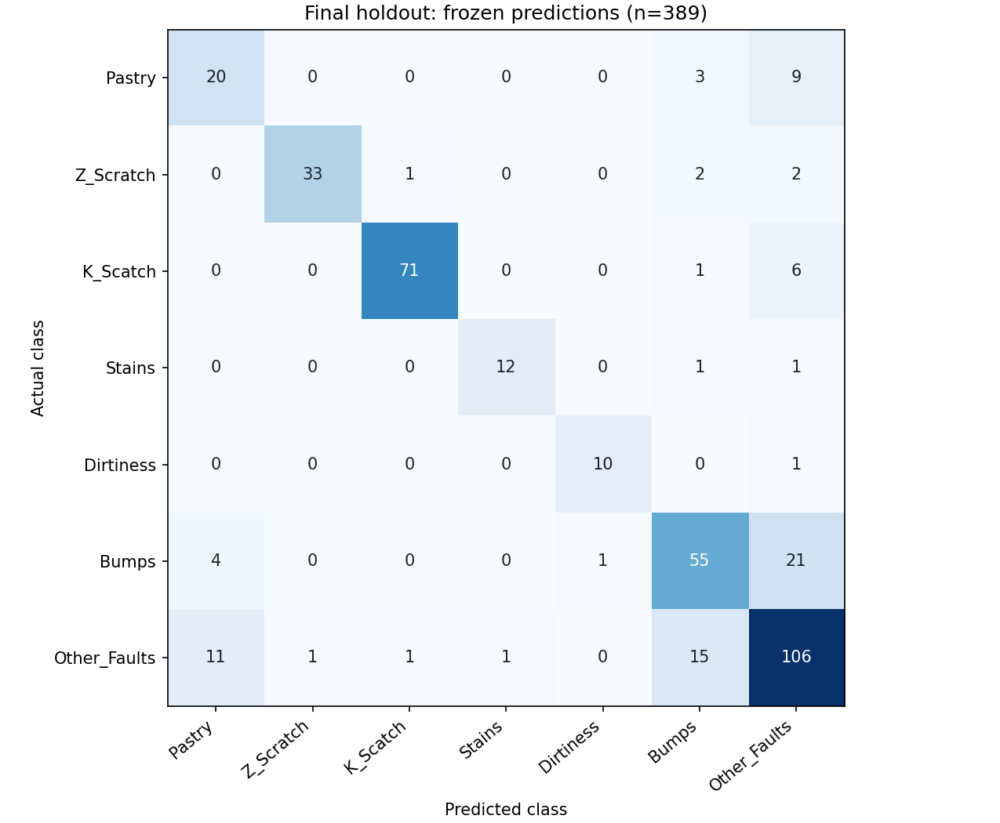
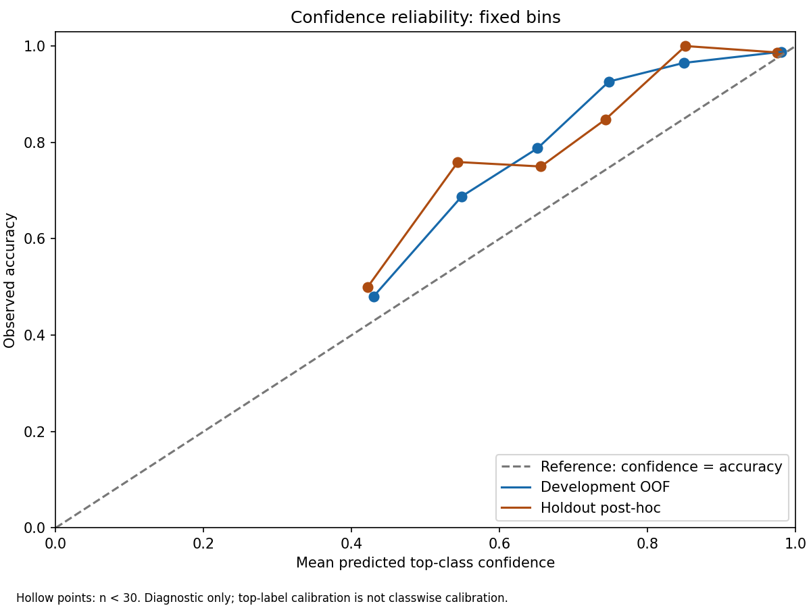
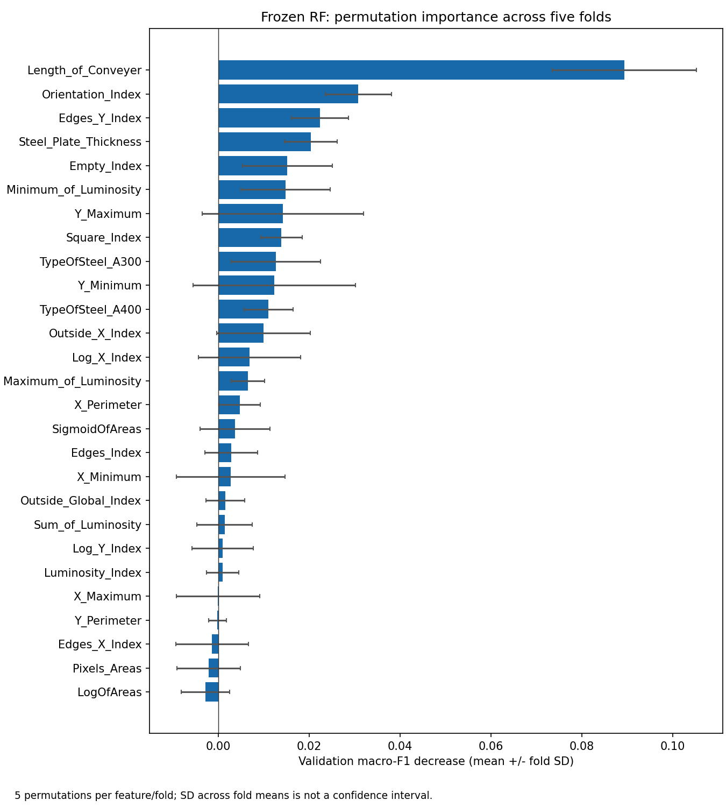

# Error analysis, uncertainty and interpretability

## 1. Purpose

Phase 9 characterizes observed errors, development uncertainty and associative
importance for the already selected model. It does not improve its score.
The 389-row final holdout remains consumed; every holdout calculation below
uses the original saved predictions. No new holdout inference is performed.

Initial read-only preflight passed: branch `feat/quality-mlops-platform`,
working tree CLEAN, `git diff --check` PASS, correct exclusive author/committer
identity, and HEAD `dfe5185b26da3133ed0a6c4b26b7bc906eae177b`.
The technical Phase 8 checkpoint is
`269b38cdced47f8c392a59b0bf9b6bbd298a363a`.
All four artifact hashes in the Phase 8 execution ledger matched. Independently
derived metrics, per-class results, confusion matrix and raw probability
snapshot matched the saved evaluation.

## 2. Frozen model

`tuned_random_forest` remains:

```python
RandomForestClassifier(
    n_estimators=300, min_samples_leaf=2, max_features="sqrt", max_depth=20,
    class_weight="balanced", random_state=42, n_jobs=1,
)
```

`FULL_OBSERVATION_FEATURES` contains exactly the 27 original predictors in
Phase 8 column order. The technical id and seven targets remain excluded.
Artifact class order is Pastry, Z_Scratch, K_Scatch, Stains, Dirtiness, Bumps,
Other_Faults. Estimator/probability scoring order is explicitly aligned to
sorted class names; argmax ties use the estimator order.

The canonical representation is UTF-8 JSON with sorted keys, compact separators
and no NaN. The config hash covers precisely the seven parameters above.
A separate contract hash covers the model name, config, feature-set name,
ordered feature list and both class orders.

```text
FINAL_MODEL_FROZEN = TRUE
FINAL_MODEL_CONFIG_HASH = fd3a6d4234befdf156869fd6614d8464aa8b2430edb19efea46e27da3823f045
POST_HOLDOUT_TUNING = FALSE
ALTERNATIVE_MODEL_EVALUATION = FALSE
FEATURE_SELECTION_AFTER_HOLDOUT = FALSE
HOLDOUT_INVALIDATED = FALSE
```

Assertions compare the exact estimator type and all parameters with the frozen
builder, validate feature membership/order and class order, and reject changes.
No final serialized estimator was saved in Phase 8. Phase 9 reconstructs the
identical training-only estimator for native importance, without persisting or
replacing a model and without asking it to predict holdout rows.

The machine-readable contract, prespecified diagnostic rules, training cuts,
policy and its pre-application hash are in
[analysis_protocol.json](../../reports/ml/error_analysis/analysis_protocol.json).

## 3. Evidence sources

**DEVELOPMENT / OOF:** 1,552 training observations, one validation prediction per
observation using the five frozen Phase 4 folds. Each estimator sees only its
fold's training rows. This is used for confidence, threshold simulations and the
candidate review policy. These same folds previously participated in tuning and
selection in Phase 7: the reconstructed OOF evidence is not nested CV, a new
test set, an unbiased post-selection estimate, or prospective policy validation.

**FINAL HOLDOUT:** 389 previously evaluated observations. Class errors, segment
diagnostics, probability diagnostics and example cases are post-hoc descriptive
analyses. Holdout predictions and final metrics are read-only and unchanged.
The candidate policy function accepts only OOF data and freezes its output
before holdout application. No holdout statistic can change its thresholds.

Original CSV data-row positions, zero-based, are used as `row_id`; they are not
model predictors. The Phase 8 partition lists are loaded directly. The analysis
does not generate or alter a split. Tests independently compare OOF membership
with the unchanged Phase 4 implementation.

## 4. Holdout error analysis

| Quantity | Observed value |
|---|---:|
| Total holdout rows | 389 |
| Correct | 307 |
| Errors | 82 |
| Error rate | 0.2107969152 |
| Final macro-F1, unchanged | 0.8146728102 |
| Final balanced accuracy, unchanged | 0.8048726800 |
| Final log-loss, unchanged | 0.6893136714 |

The saved confusion matrix sums to 389 and its diagonal sums to 307. All errors
are retained, including apparently anomalous or high-confidence errors.

## 5. Per-class analysis

`MIN_SAMPLE=30` was fixed before interpreting Phase 9 tables. It is a pragmatic
descriptive flag, not a guarantee of statistical precision or stability. At
n=30 a proportion near 0.5 still has substantial sampling uncertainty.
For n>=30, F1>=0.85 is STRONGER, F1<0.70 is WEAKER, otherwise INTERMEDIATE.
These coarse, explicitly chosen descriptive cutoffs are not acceptance criteria,
statistical tests or an operational SLA. Support takes precedence over F1.

| Actual class | n | TP | FN | FP | Precision | Recall | F1 | Error rate | Status |
|---|---:|---:|---:|---:|---:|---:|---:|---:|---|
| Pastry | 32 | 20 | 12 | 15 | .571429 | .625000 | .597015 | .375000 | WEAKER |
| Z_Scratch | 38 | 33 | 5 | 1 | .970588 | .868421 | .916667 | .131579 | STRONGER |
| K_Scatch | 78 | 71 | 7 | 2 | .972603 | .910256 | .940397 | .089744 | STRONGER |
| Stains | 14 | 12 | 2 | 1 | .923077 | .857143 | .888889 | .142857 | INSUFFICIENT_SUPPORT |
| Dirtiness | 11 | 10 | 1 | 1 | .909091 | .909091 | .909091 | .090909 | INSUFFICIENT_SUPPORT |
| Bumps | 81 | 55 | 26 | 22 | .714286 | .679012 | .696203 | .320988 | WEAKER |
| Other_Faults | 135 | 106 | 29 | 40 | .726027 | .785185 | .754448 | .214815 | INTERMEDIATE |

Stains and Dirtiness cannot be called operationally stable from 14 and 11 cases.
Pastry has the highest observed within-class error rate. Other_Faults and Bumps
contribute the largest absolute counts of missed actual classes (29 and 26).

## 6. Confusion patterns

The off-diagonal ranking uses count descending, then actual/predicted class
ascending to break ties. Percentages have the actual-class support denominator.

| Actual -> predicted | Errors | Percent of actual class |
|---|---:|---:|
| Bumps -> Other_Faults | 21 | 25.9259% |
| Other_Faults -> Bumps | 15 | 11.1111% |
| Other_Faults -> Pastry | 11 | 8.1481% |
| Pastry -> Other_Faults | 9 | 28.1250% |
| K_Scatch -> Other_Faults | 6 | 7.6923% |

The two directions of Bumps/Other_Faults account for 36 of 82 errors.
The analytic CSV includes every off-diagonal pair, including zero counts;
the diagonal is excluded. The count-annotated figure exposes both correct
classifications and asymmetric confusions.



## 7. Segment analysis

Every one of the 27 predictors is considered. Continuous cuts are the unique
25th/50th/75th percentiles of TRAINING only, with pandas linear interpolation.
Intervals are right-closed with unbounded end intervals; repeated quantile values
are deduplicated before any error is examined. Steel indicators use 0/1 groups.
Frozen cuts are stored in the protocol. No outcome-driven bins or merging occur.

The complete table has 103 overall segments and 721 class-by-segment rows.
Each feature's overall groups partition all 389 holdout observations and all
82 errors. Segment comparisons overlap across features and are exploratory,
without adjustment for multiple comparisons or evidence of causal effects.
Class mix and correlated predictors can explain apparent segment differences.

| Feature | Training-defined segment | n | Correct | Errors | Error rate |
|---|---|---:|---:|---:|---:|
| Steel_Plate_Thickness | <=40 | 127 | 103 | 24 | 18.90% |
| Steel_Plate_Thickness | (40,69] | 46 | 37 | 9 | 19.57% |
| Steel_Plate_Thickness | (69,80] | 107 | 88 | 19 | 17.76% |
| Steel_Plate_Thickness | >80 | 109 | 79 | 30 | 27.52% |
| TypeOfSteel_A300 | 0 | 233 | 186 | 47 | 20.17% |
| TypeOfSteel_A300 | 1 | 156 | 121 | 35 | 22.44% |
| TypeOfSteel_A400 | 0 | 156 | 121 | 35 | 22.44% |
| TypeOfSteel_A400 | 1 | 233 | 186 | 47 | 20.17% |
| Pixels_Areas | <=85 | 103 | 79 | 24 | 23.30% |
| Pixels_Areas | (85,170.5] | 83 | 60 | 23 | 27.71% |
| Pixels_Areas | (170.5,822.5] | 106 | 80 | 26 | 24.53% |
| Pixels_Areas | >822.5 | 97 | 88 | 9 | 9.28% |

Among adequately supported bins, the highest observed error proportion is
Log_X_Index<=1: 38/107 (35.51%). This ranking is a post-hoc diagnostic, not a
prespecified significant finding. Steel indicators are complementary and their
two views are the same comparison, not independent replication.

Two overall segments are INSUFFICIENT_DATA: Edges_Y_Index>1 and
Outside_Global_Index>1, both n=0. They are retained as explicitly empty
prespecified tail intervals. Of the class-by-segment rows, 597 have n<30;
no stability conclusion is drawn from them. A missing rate for n=0 is not zero
error. No artifact file is empty.

The CSV includes nominal 95% Wilson intervals as descriptive binomial
uncertainty summaries. They presume independent observations and are neither
simultaneous intervals nor evidence that plant observations are independent.
The exact bounds for zero/all errors are represented as 0/1 without residual
floating-point error.

## 8. OOF uncertainty

`StratifiedKFold(n_splits=5, shuffle=True, random_state=42)` runs on sorted
training positions in the same order as Phase 4. The fold audit records train
and validation row ids. There are 1,552 predictions, zero duplicates and zero
missing rows. Runtime test spies verify every prediction, including permutation
scoring, uses rows disjoint from that estimator's fit; exactly five fold fits
and one full-training native-importance fit occur.

| OOF metric | Value |
|---|---:|
| Accuracy | 0.7706185567 |
| Balanced accuracy | 0.7931890745 |
| Macro precision | 0.8095993668 |
| Macro recall | 0.7931890745 |
| Macro-F1 | 0.8007785609 |
| Weighted F1 | 0.7718179804 |
| Log-loss | 0.6319366388 |

Every fold metric matches the frozen Phase 7 evaluation within absolute 1e-12.
The mean fold macro-F1 rounds to 0.8008 and its sample SD to 0.0282.
Pooled OOF macro-F1 and mean fold macro-F1 need not be identical because F1 is
nonlinear. This comparison checks reconstruction, not final generalization.

Top-1 is the largest probability, top-2 the second largest, and margin their
difference. Confidence bins were fixed before generating the table; 1.00
belongs in the final interval.

| Top-1 bin | n | Coverage | Accuracy | Error rate | Mean confidence |
|---|---:|---:|---:|---:|---:|
| [0,.50) | 387 | 24.94% | 48.06% | 51.94% | .429814 |
| [.50,.60) | 266 | 17.14% | 68.80% | 31.20% | .548808 |
| [.60,.70) | 231 | 14.88% | 78.79% | 21.21% | .651243 |
| [.70,.80) | 190 | 12.24% | 92.63% | 7.37% | .747760 |
| [.80,.90) | 143 | 9.21% | 96.50% | 3.50% | .848973 |
| [.90,1] | 335 | 21.59% | 98.81% | 1.19% | .980831 |

All OOF confidence bins have n>=30. Observed error decreases with these fixed
confidence bins. Separately fixed margin bins [0,.1), [.1,.2), [.2,.4), [.4,.6),
[.6,.8), [.8,1] have error rates 52.38%, 47.64%, 31.60%, 15.14%, 4.72%, 1.10%.
This descriptive association adds context, not causality; margin is not needed
to complicate the candidate policy.

## 9. Calibration diagnostics

Multiclass Brier score is
`mean_i sum_k (p_ik - 1[y_i=k])^2`, without dividing by class count; its
range is [0,2]. Log-loss uses all seven probabilities with explicit class
alignment and scikit-learn's standard numerical clipping for zero probabilities.

Top-label ECE is `sum_b (n_b/N)*abs(accuracy_b-mean_top1_b)`, using precisely the
fixed confidence bins above and zero contribution from empty bins.
It is bin-dependent, not a universal calibration measure or classwise test.

| Diagnostic | Development OOF | Final holdout post-hoc |
|---|---:|---:|
| Multiclass log-loss | .6319366388 | .6893136714 |
| Multiclass Brier | .3255692037 | .3136610903 |
| Top-label ECE | .0909704125 | .1004902772 |
| Mean top-1 confidence | .6796481442 | .6887128076 |
| Observed accuracy | .7706185567 | .7892030848 |

Both sources show aggregate top-label underconfidence: accuracy exceeds mean
confidence. That does not prevent extreme overconfident mistakes on individual
rows, including predictions with confidence exactly one. Holdout log-loss is
higher while Brier is lower; the measures emphasize different aspects.

`PROBABILITY_BEHAVIOR=UNCERTAIN`: the broad direction is similar, but these
descriptive summaries establish neither equivalence nor a proven distribution
shift. No independent equivalence test or prospective calibration validation
was specified. No calibrator was fitted.
`HOLDOUT_CALIBRATION_DIAGNOSTIC=POST_HOC_CALIBRATION_DIAGNOSTIC`, never
`VALIDATED_CALIBRATION_MODEL`.

The reliability plot is confidence calibration for the predicted class,
not seven separate classwise reliability curves or proof of perfect calibration.



## 10. Threshold trade-off

Only OOF is used. These four thresholds are fixed; there is no continuous
threshold search or optimization.

| Threshold | Accepted | Review | Coverage | Review rate | Accepted accuracy | Accepted error | High-confidence errors |
|---|---:|---:|---:|---:|---:|---:|---:|
| .60 | 899 | 653 | 57.93% | 42.07% | 91.99% | 8.01% | 72 |
| .70 | 668 | 884 | 43.04% | 56.96% | 96.56% | 3.44% | 23 |
| .80 | 478 | 1074 | 30.80% | 69.20% | 98.12% | 1.88% | 9 |
| .90 | 335 | 1217 | 21.59% | 78.41% | 98.81% | 1.19% | 4 |

Higher thresholds reduce accepted coverage and increase review workload.
No error cost, review capacity or class-specific service requirement has been
validated, so none of these rows establishes an optimal operating point.
The aggregate accepted error rate also masks class mix: grouping the saved OOF
rows by actual class at .80 gives 7 errors among 54 accepted Other_Faults
(12.96%). Only 4 Pastry, 11 Dirtiness and 24 Bumps cases are accepted, each
below MIN_SAMPLE. K_Scatch contributes 266 of the 478 accepted rows. These
retrospective actual labels are unavailable at prediction time; this finding
does not create a new class-specific rule or show uniform class-level safety.

## 11. Candidate review policy

The .80 candidate carries forward the exploratory Phase 7 threshold and was
fixed before Phase 9 calculations. It was not selected from holdout or chosen
as the best row of the table. The simple OOF support rule required n>=30 in
each of the low/middle/high groups and strictly decreasing group error rates.
Observed groups meet that descriptive rule:

| Label | Rule | OOF n | OOF error rate | Simulated action |
|---|---|---:|---:|---|
| LOW_CONFIDENCE | top-1 < .50 | 387 | 51.94% | candidate_review |
| REVIEW_REQUIRED | .50 <= top-1 < .80 | 687 | 21.25% | candidate_review |
| HIGH_CONFIDENCE | top-1 >= .80 | 478 | 1.88% | candidate_auto_accept |

Both lower groups require review in the simulation. No additional margin,
class or segment rules are introduced.

`POLICY_STATUS=DEVELOPMENT_ONLY`. The policy was developed after final holdout
consumption and uses post-selection development predictions. It is not a
validated production threshold or operational SLA.

After hashing/freezing the candidate, applying it unchanged to holdout gives
`POST_HOC_ONLY`: 128 accepted, 261 review, coverage 32.90%, review rate 67.10%,
accepted error rate 1/128=0.78125%, 81 errors sent to review and 1 not captured.
Sending an error to review does not prove a human would correct it; reviewer
accuracy, cost and capacity are unknown. These figures do not replace Phase 8
metrics or independently validate the policy.

## 12. High-confidence errors

All 9 OOF and 1 holdout errors at confidence>=.80 are retained with row ids,
actual/predicted labels, confidence, margin and all 27 feature values.
OOF row 1276 and holdout row 1277 are Other_Faults predicted K_Scatch with
confidence=1 and margin=1. This observation alone does not establish their
physical relationship, a labeling error or a causal mechanism.

No observation is removed or relabeled. The full row listing is in
[high_confidence_errors.csv](../../reports/ml/error_analysis/high_confidence_errors.csv).

## 13. Global interpretability

Native mean-decrease-in-impurity importance comes from the identically
reconstructed full-training RF. It is associative, can favor predictors with
more candidate splits, and is not a physical or causal decomposition.

| Native rank | Feature | Importance |
|---|---|---:|
| 1 | Length_of_Conveyer | .067571 |
| 2 | Pixels_Areas | .064636 |
| 3 | LogOfAreas | .056842 |
| 4 | Sum_of_Luminosity | .054961 |
| 5 | Outside_X_Index | .048247 |

Permutation importance measures the decrease in validation macro-F1 when one
column is permuted. Five repeats with random_state=42 and n_jobs=1 are computed
for all 27 features in each of the five validation folds using that fold's RF.
The 675 repeat values are retained. No holdout scoring is involved.

| Permutation feature | Mean decrease | Fold SD | Min fold mean | Max fold mean | Positive folds |
|---|---:|---:|---:|---:|---:|
| Length_of_Conveyer | .089402 | .015872 | .073732 | .108790 | 5 |
| Orientation_Index | .030840 | .007308 | .023505 | .042210 | 5 |
| Edges_Y_Index | .022374 | .006232 | .017303 | .033176 | 5 |
| Steel_Plate_Thickness | .020412 | .005795 | .011285 | .026076 | 5 |
| Empty_Index | .015220 | .009857 | .009225 | .032703 | 5 |

The Phase 1 correlation review already documented TypeOfSteel_A300/A400 r=-1,
Y_Minimum/Y_Maximum about 1, X_Minimum/X_Maximum about .99,
Pixels_Areas/Sum_of_Luminosity about .98 and Pixels_Areas/X_Perimeter about .97,
as well as correlated log/area indices. Permuting one predictor can distribute
or suppress importance among correlated substitutes and can create implausible
feature combinations. Thus low or negative individual permutation importance
does not show that a variable is dispensable or harmful.

Length_of_Conveyer's association warrants provenance review before operational
interpretation: it could reflect product mix or collection conditions. Its
ranking does not establish that changing conveyor length would change defects.
No variable is removed, and no reduced model is trained.

`ASSOCIATION_NOT_CAUSATION=TRUE`.
`SHAP_STATUS=NOT_REQUIRED`: native importance, fold permutation stability and
explicit case context answer this phase's questions without another dependency
or an unvalidated local explanation method. No SHAP installation or invocation was performed during Phase 9.



## 14. Importance stability

Importance mean is the equally weighted mean of the five fold means.
Importance SD is sample SD (ddof=1) across those five means, not across all
675 values. Min/max and positive_fold_count also refer to fold means.
Training sets overlap, so fold values are not independent replications; the SD
is not a confidence interval or significance test.

Prespecified descriptive rules: mean<=0 is LOW_IMPORTANCE; otherwise positive
in all five folds and SD<=mean is STABLE_IMPORTANCE; remaining positive means
are VARIABLE_IMPORTANCE. Results: 11 stable, 11 variable, 5 low.

For example Y_Maximum (.014221 +/- .017793) and Y_Minimum
(.012340 +/- .017832) are variable and positive in only four folds.
The five leading permutation features are stable under this descriptive rule.
All 27 features remain in every estimator. Fingerprints before/after native
and permutation calculations verify no estimator mutation.

## 15. Case-level examples

Rules were defined before selecting rows: use saved holdout predictions;
HIGH means confidence>=.80, LOW means confidence<.50; require the named
correct/error outcome; choose highest confidence for HIGH or lowest for LOW,
then the smallest row_id on ties. Missing categories would be reported explicitly.

| Case | row_id | Actual | Predicted | Confidence | Margin | Policy label |
|---|---:|---|---|---:|---:|---|
| HIGH_CONFIDENCE_CORRECT | 412 | K_Scatch | K_Scatch | 1.000000 | 1.000000 | HIGH_CONFIDENCE |
| LOW_CONFIDENCE_CORRECT | 1567 | Other_Faults | Other_Faults | .302034 | .057109 | LOW_CONFIDENCE |
| HIGH_CONFIDENCE_ERROR | 1277 | Other_Faults | K_Scatch | 1.000000 | 1.000000 | HIGH_CONFIDENCE |
| LOW_CONFIDENCE_ERROR | 968 | Bumps | Other_Faults | .274936 | .022813 | LOW_CONFIDENCE |

The JSON provides values of the top five global permutation features for each
case. These are context variables associated with the model globally, not
local feature contributions or explanations of what caused that decision.
There is no manual selection of visually convenient examples.

## 16. Limitations

- Validity is FULL_OBSERVATION_CLASSIFICATION_ONLY; EARLY_PREDICTION_SUPPORTED=FALSE.
  Image-derived measurements may be available only after defect inspection.
- There are no good/non-defective plates. This is conditional defect-type
  classification, not good-versus-bad detection.
- No valid temporal variable demonstrates prediction of future defect appearance.
  Timestamps, machine, shift, supplier and production sequence suitable for
  operational inference are not demonstrated.
- Minority classes and many class/segment groups have insufficient support.
  Neither an n>=30 flag nor a high observed metric proves operational stability.
- The original random split and logical holdout sealing are inherited.
  No exact duplicate 27-feature vectors were found anywhere in the CSV or
  shared across train/holdout, but entity, batch or temporal independence
  cannot be established without the missing provenance.
- Confidence policy lacks prospective independent validation and reuses folds
  involved in model selection. Human-review performance and cost are unknown.
- Calibration diagnostics do not create a calibrated model; ECE is bin-dependent
  and top-label reliability does not establish classwise or subgroup calibration.
- Feature importance is associative and affected by correlation, sample size,
  metric choice and overlapping training folds.
- No actual financial impact or real production performance is demonstrated.
  Plant integration, monitoring requirements and Power BI data contracts remain
  future work. Power BI itself is unchanged.

## 17. What this phase does NOT prove

The evidence does not prove early prediction, future defect prevention, causal
effects, calibrated probabilities, an optimal review threshold, an operational
SLA, human correction of reviewed cases, deployment readiness, stable behavior
on a new plant or future data, or financial benefit. It does not authorize a
new model selection or a new use of this consumed holdout for policy design.

## 18. Gate result

Full pytest result: **91 passed in 592.35 seconds (0:09:52)**.
The complete suite passed after the corrections below. Numerical artifacts
reproduced within absolute 1e-12, and all three PNGs reproduced byte-for-byte.
The final code/data/Phase 8/Power BI scope checks and git diff checks passed.

The first focused run recorded 15 passes and one failure:
`test_segments_partition_and_small_samples_are_marked` detected a positive
floating-point residue in the Wilson lower bound at zero observed errors.
The implementation now sets mathematically exact 0/1 endpoint bounds; the
assertion was not relaxed. Six parameterized endpoint regression cases were
added. Visual inspection also caught clipped titles on two figures; their
layout bounds were corrected, and byte-for-byte figure replay is tested.
An initial oversized Windows write command failed with OS error 206 before
writing; file creation was split into smaller commands.

The complete suite includes inherited development-only regression tests for
Phase 7 search APIs. Those tests are not a Phase 9 tuning exercise, selection
decision or alternative-model evaluation on holdout. They do not write or
promote a new candidate or modify frozen evidence.

Adversarial check:

| Challenge | Evidence / answer |
|---|---|
| Is OOF actually out of fold? | Five exact Phase 4 memberships; each training row validated once. |
| Any row fit and predicted by the same estimator? | Runtime spies assert disjoint indices on every diagnostic prediction. |
| Were thresholds chosen using holdout? | Fixed .60/.70/.80/.90 grid; .80 carried from Phase 7; candidate accepts only OOF input and is hashed before application. |
| Are confidence and calibration conflated? | No: ECE/Brier/log-loss are diagnostic; extreme errors remain visible. |
| Is importance called causal? | No: correlation/proxy effects and absence of local attribution are explicit. |
| Do small segments support conclusions? | n<30 flagged; empty rates undefined; no operational stability claim. |
| Did the model or features change? | Exact parameter, class and ordered 27-feature assertions; no old source changes. |
| Are holdout predictions identical? | Original SHA-256s, snapshot equality and metric/CM reproduction; no new holdout model invocation. |
| Is policy independently validated? | No: DEVELOPMENT_ONLY, with POST_HOC_ONLY holdout application. |
| Are artifacts reproducible? | Independent replay compares all numerical artifacts at absolute 1e-12 and figure bytes. |

Reproduction from the repository root, in the recorded existing environment
(Python 3.13.7, NumPy 2.2.6, pandas 2.3.3, scikit-learn 1.7.1,
Matplotlib 3.10.5):

```powershell
$env:PYTHONPATH = 'src;.'
$env:MPLCONFIGDIR = Join-Path (Get-Location) '.pytest_cache/phase9-matplotlib'
python -B -m quality_ml.evaluation
python -B -m pytest -q -p no:cacheprovider
git diff --check
```

Use the per-command safe.directory exception if required; do not modify global
Git configuration. No network access, installation, background service, remote
creation or push is needed. Numerical replay tolerance is absolute 1e-12 and
relative 0 in this environment; image equality is checked in the same rendering
environment. Byte hashes intentionally protect the original Phase 8 snapshot;
line-ending conversions of those files will fail closed rather than silently
replace the evidence. No Phase 8 evaluation command should be rerun.

Artifact inventory (all under `reports/ml/`):

- `error_analysis/`: confusion_pairs.csv, class_error_summary.csv,
  segment_errors.csv, high_confidence_errors.csv, confusion_matrix.png,
  analysis_protocol.json, analysis_summary.json.
- `uncertainty/`: oof_predictions.csv, oof_fold_audit.json,
  confidence_bins.csv, margin_bins.csv, holdout_confidence_bins.csv,
  threshold_tradeoff.csv, calibration_metrics.json, reliability.png.
- `interpretability/`: native_feature_importance.csv,
  permutation_importance.csv, permutation_by_fold.csv, case_examples.json,
  feature_importance.png.

The extra audit/protocol/repeat files preserve row membership, frozen decisions,
and stability evidence; the two additional bin tables substantiate margin
analysis and the holdout reliability curve. No dashboard or duplicate model
artifact is created.

```text
VERDICT = PASS_WITH_LIMITATION
POLICY_STATUS = DEVELOPMENT_ONLY
POWER_BI_STATUS = CLEAN
HOLDOUT_STATUS = CONSUMED_FINAL_EVALUATION
HOLDOUT_INVALIDATED = FALSE
VALIDITY_SCOPE = FULL_OBSERVATION_CLASSIFICATION_ONLY
EARLY_PREDICTION_SUPPORTED = FALSE
```
